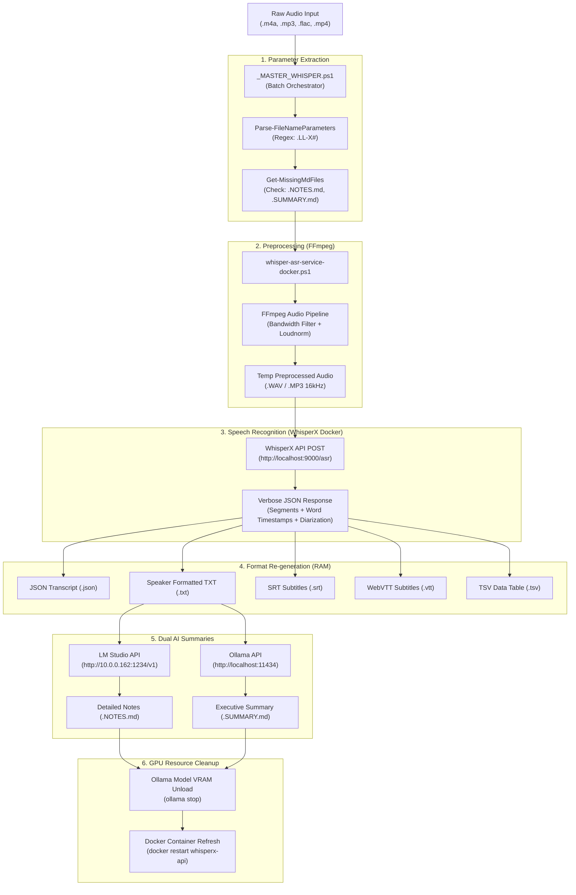

# WHISPER Technical Architecture & Design

This document details the end-to-end technical architecture, data processing pipeline, profile definitions, and service integrations of the WHISPER project.

---

## 1. System Overview

WHISPER is a modular, high-throughput audio transcription and AI summarization pipeline designed for Windows environments. It bridges PowerShell automation with local/remote containerized inference engines:



---

## 2. Audio Preprocessing Profiles (FFmpeg)

Each profile applies specialized DSP (Digital Signal Processing) filter chains to optimize voice clarity before sending audio to WhisperX:

| Profile | Suffix Identifier | Bandwidth Filters | Normalization & Dynamics | Best For |
| :--- | :--- | :--- | :--- | :--- |
| **`phone`** | `PHONE-NORM_HP-LW-SP-LN` | Highpass: 200 Hz<br>Lowpass: 3500 Hz | `speechnorm=e=10:r=0.0005:l=1`<br>`loudnorm=I=-16:TP=-1.5:LRA=11` | Cell phone calls, landlines, low-bitrate recordings |
| **`meeting`** | `MEETING-NORM_HP-LW-DN` | Highpass: 80 Hz<br>Lowpass: 8000 Hz | `dynaudnorm=p=0.9:m=50:s=5:g=15`<br>`loudnorm=I=-16:TP=-1.5:LRA=11` | Multi-person conference room meetings, webinars |
| **`distant`** | `DISTANT-NORM_HP-LP-AC-SN` | Highpass: 200 Hz<br>Lowpass: 4000 Hz | `acompressor=threshold=-20dB:ratio=10`<br>`speechnorm=e=30:r=0.0001:l=1`<br>`loudnorm=I=-16:TP=-1.5:LRA=11` | Far-field microphones, noisy ambient environments |

---

## 3. Output Formats Generated in a Single Pass

To maximize GPU efficiency, the WhisperX API is invoked once to retrieve full diarized JSON data. PowerShell then reconstructs all secondary formats in RAM:

1. **`{basename}.json`**: Full raw WhisperX payload with word-level alignments, speaker IDs, and probabilities.
2. **`{basename}.txt`**: Clean transcript with speaker tags (e.g. `[SPEAKER_00]: Hello.`).
3. **`{basename}.srt`**: SubRip subtitle format with `00:00:00,000` timestamps and speaker labels.
4. **`{basename}.vtt`**: WebVTT subtitle format with `00:00:00.000` timestamps and speaker labels.
5. **`{basename}.tsv`**: Tab-separated value file (`start\tend\tspeaker\ttext`) for spreadsheet analysis.
6. **`{basename}.NOTES.md`**: Deep structured notes generated by LM Studio.
7. **`{basename}.SUMMARY.md`**: High-level summary generated by Ollama.
8. **`{basename}.WHISPER.YYYYMMDD-HHmmss.log`**: Complete execution telemetry and hardware metadata log.

---

## 4. Hardware Telemetry & Performance Metrics

On every transcription run, [src/whisper-asr-service-docker.ps1](file:///d:/_DOCUMENTS/_SCRIPTS/WHISPER/src/whisper-asr-service-docker.ps1) gathers system hardware metrics via WMI/CIM and calculates processing throughput:

* **Real-Time Factor (RTF)**:
  $$\text{RTF} = \frac{\text{Processing Time (s)}}{\text{Audio Duration (s)}}$$
  *(Values $< 1.0$ indicate faster-than-realtime transcription).*
* **Tokens Per Second (TPS)**:
  $$\text{TPS} = \frac{\text{Approximate Token Count}}{\text{Processing Time (s)}}$$
* **Hardware Inventory**: CPU cores, RAM modules, GPU driver version, motherboard model, and OS build recorded in JSON logs.

---

## 5. Configuration Architecture

```text
config/
├── config.default.json        # Base configuration (tracked in Git)
└── config.local.json          # Optional local override (git-ignored)
```

The configuration loader automatically checks for `config.local.json` first. If present, any local properties override `config.default.json` without modifying tracked repository files.
